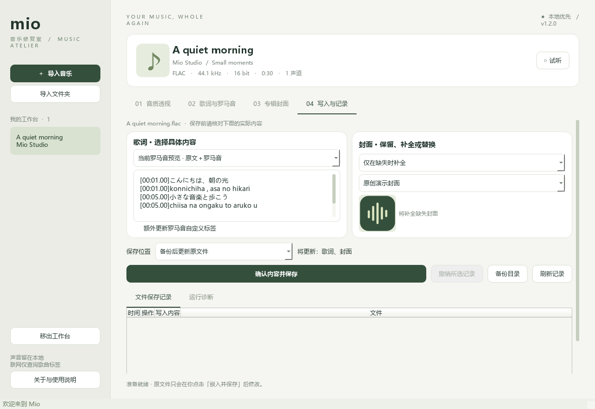

<p align="center"></p>
<h1 align="center">Mio 音乐修复室</h1>
<p align="center">让每一首歌，完整如初。<br>Windows 本地音乐频谱分析 · 歌词与日语罗马音 · 专辑封面安全嵌入</p>
<p align="center"><a href="https://github.com/Akumy-01/mio-music/releases/latest">下载 Windows 版本</a> · <a href="docs/PRODUCT.md">产品企划</a> · <a href="docs/ARCHITECTURE.md">架构与算法</a> · <a href="docs/USER_GUIDE.md">完整使用说明</a></p>


Mio 是面向本地音乐收藏者的 Windows 桌面应用。把文件或文件夹拖进工作台，查看音质证据、找回歌词、为日语歌词生成罗马音，再把缺失的封面和校对过的歌词写回音乐文件。界面采用暖白、鼠尾草绿与深森林绿，使用轻量淡入动效，让信息清晰、操作安静。

**关于“真无损”：目前没有一个仅凭频谱就能绝对证明音源是真无损的算法。** Mio 给出“有损编码 / 疑似有损转码 / 未见明显转码迹象 / 证据不足”，同时展示依据。无损容器不保证来源无损；高采样率、高位深也不构成音源认证。

## v1.2.0 · Spotify 与可选择的写入方案

新增 [Spotify 歌词接入](docs/SPOTIFY.md)：连接用户自己的 spotify-lyrics-api 服务，粘贴歌曲链接获取歌词。随包提供服务源码与 Docker 启动脚本，需自行配置账号会话；真实账号获取尚未验证。

“写入与记录”重新设计为双卡片内容预览，可选择具体歌词版本、原文＋罗马音、具体封面以及保留/补全/替换策略；支持另存整理副本、独立罗马音标签、结构化记录与选中记录撤销。修复 Windows 试听资源占用文件的风险，并对实际文件锁进行回归验证。



60 项自动测试通过。现有网易云、酷狗、LRCLIB 多源查询继续保留。详见 [更新说明](docs/RELEASE_NOTES.md)。

## 下载与启动

1. 打开 [Releases](https://github.com/Akumy-01/mio-music/releases)，下载 `MioMusic-windows-x64.zip`。
2. 完整解压到可写目录，双击其中的 `MioMusic.exe`。请保留 `_internal` 目录。
3. 无需另装 Python、FFmpeg 或 API 密钥。需要 Windows 10 / 11 x64。

发布包为便携版，尚未购买 Windows 代码签名证书。Windows 可能显示未知发布者提示；可对照发布页 SHA-256 校验文件。当前版本已在 Windows 环境构建与测试，尚未覆盖所有系统版本、硬件和第三方播放器。

## 能做什么

| 功能 | 当前实现 |
|---|---|
| 导入 | 多文件选择、文件夹递归、拖放、重复路径去重、损坏文件跳过 |
| 音频格式 | 分析 FLAC、MP3、M4A、WAV、OGG、OPUS、AIFF；内嵌写入 FLAC、MP3、M4A |
| 频谱 | 原采样率 STFT、最多三段各 12 秒抽样、有效带宽估计、峰值、JSON 报告导出 |
| 音质判读 | 结合编码与频谱的启发式结论，明确说明推断限制 |
| 歌词匹配 | 网易云音乐 / 酷狗音乐 / LRCLIB 并行搜索；独立故障隔离、手动选源、来源状态、缓存回退 |
| 歌词编辑 | LRC / 纯文本预览与修改、本地 UTF-8 导入、导出 |
| 日语罗马音 | 优先展示来源提供的罗马音；也可 pykakasi 离线转写、保留 LRC 时间戳、编辑与导出 |
| 封面补全 | MusicBrainz 发行版查询 + Cover Art Archive 正面封面；支持本地图片 |
| 安全保存 | 自选歌词与封面、保存前预览、SHA-256 备份、原子替换、另存副本、文件锁保护 |
| 回溯 | 保存记录表、选中记录撤销、运行诊断独立显示、持久 JSONL 与完整备份 |
| 试听 | Qt Multimedia 本地播放 / 暂停；兼容性取决于当前音频编码 |
| 交互 | 原生桌面窗口、230ms 淡入、切换歌曲保留本次会话编辑草稿 |


截图音频为程序合成，日语文本为原创演示；没有把他人的完整歌词或商业专辑封面提交到仓库。

## 五步整理一首歌

1. **导入**音乐；标签缺失时用文件名显示曲名，可在搜索框手动修正匹配信息。
2. 在**音质透视**点击“分析频谱”，阅读结论与说明，必要时导出报告。
3. 在**歌词与罗马音**确认曲名、歌手并查询，默认同时搜索网易云、酷狗、LRCLIB；选择候选后后台获取歌词。可手动指定来源，勾选译文或强制联网。请确认演唱者、专辑、时长和版本。日语歌词点击“生成日语罗马音”，人工校对专有名词和特殊读音。
4. 在**专辑封面**填写专辑，查询后选择具体发行版，下载预览；无封面或联网失败时可选本地图片。
5. 在**写入与记录**选择具体歌词、封面与保存位置，核对预览后点击“确认内容并保存”。Mio 自动备份后写入，并支持选中记录撤销。

标准歌词字段可选择原文、编辑内容或原文＋罗马音预览；自定义罗马音标签独立可选更新，未选择时保留原值。需要通用播放器显示双行歌词时，可以“导出当前歌词”，得到双行 LRC。标准嵌入歌词通常作为普通文本显示；同步播放取决于播放器，Mio 自身暂不提供逐字卡拉 OK。

**只有点击“确认内容并保存”才会修改音乐文件。** 查询框的曲名、歌手、专辑仅用于搜索，不会自动改写基本标签。Mio 不自动选择并批量覆盖联网结果。

## 数据与安全

- 音频解码、频谱计算、罗马音生成都在本机完成。**不上传音频文件。**
- 联网时向网易云、酷狗与 LRCLIB 发送曲名、歌手等查询信息（酷狗还使用时长）；选择候选后向对应来源发送歌曲 ID 或歌词 ID；向 MusicBrainz 发送专辑和歌手；下载封面时发送发行版 ID。服务会获得正常网络连接信息。
- JSON 查询缓存位于 `%LOCALAPPDATA%/MioMusic/cache`；歌词搜索缓存一天、歌词正文缓存七天，网络故障时可回退三十天内缓存并明确标记；封面元数据缓存七天；可手动删除此目录清理。无遥测、无账户注册、无隐藏密钥。
- 原文件备份位于音乐目录的 `.mio/backups/`；日志位于 `.mio/history.jsonl`，包含本地路径、哈希和来源说明。备份保留，不会自动清理。
- 写入操作不重编码音频。选择“替换封面”只替换正面图，保留 FLAC / MP3 的其他类型图片；另存副本不会覆盖已有目标文件。自动化测试已验证 FLAC / MP3 / ALAC M4A 的写入前后解码样本一致，且撤销恢复原文件哈希。
- 若原文件在操作期间变化，或撤销前又被其他程序修改，会拒绝覆盖。

## 局限与故障排查

- **不是无损认证工具**：三段抽样可能漏掉局部问题；模拟录音、老母带、低通滤波、低电平高频都可能导致误判。阈值是保守的工程启发式，未进行大规模标注数据集准确率认证。
- **联网匹配不保证覆盖**：任何来源都可能缺少歌词；单源故障会跳过，状态直接显示在候选列表上方，不再用单个 503 中断整次搜索；同名歌曲、翻唱、现场版需人工确认。MusicBrainz 发行版存在不代表 Cover Art Archive 一定有图片；404 时尝试其他发行版或本地封面。429 / 5xx 会有限重试。
- **罗马音不是人工标音**：多音汉字、人名、特殊歌词读音需要人工校正。纯汉字且完全没有假名的文本不会自动当成日语，避免误转中文；可手动填写罗马音预览。转写不会翻译歌词。
- **写入范围有意收敛**：WAV / OGG / OPUS / AIFF 暂只支持分析与歌词导出，避免容器兼容性问题。M4A 支持 AAC / ALAC 容器；AAC 会判为有损编码。
- **磁盘与权限**：临时副本和备份需要额外磁盘空间，音乐目录必须可写。文件被其他播放器锁定时，关闭占用程序再试。
- **当前版本没有**音频指纹识曲、波形编辑、自动增益、音频转码、翻译、全曲流式分析、云同步、自动更新、安装向导。它是一款单文件逐首整理的工作台。
- 会话草稿在切换歌曲时保留，关闭应用后不保留；需要保留时导出歌词或嵌入文件。

更多操作与备份恢复方式见 [使用说明](docs/USER_GUIDE.md)。

## 开发与构建

推荐 Windows x64 + Python 3.14。源码也可在其他支持 Qt 的系统运行，但当前发布目标是 Windows。

```powershell
git clone https://github.com/Akumy-01/mio-music.git
cd mio-music
python -m venv .venv
.\.venv\Scripts\python -m pip install -r requirements-lock.txt
.\.venv\Scripts\python main.py
```

`requirements.txt` 为直接运行依赖范围；`requirements-lock.txt` 为本次 Windows 构建的精确依赖（含测试与打包工具）。

```powershell
# 测试音频保真、标签写入、备份、撤销、罗马音、匹配排序和 GUI 线程
.\.venv\Scripts\python -m pytest -q

# 构建便携桌面应用
.\scripts\build.ps1

# 界面预览截图（使用原创合成音频）
.\.venv\Scripts\python scripts/preview.py
```

输出为 `dist/MioMusic/MioMusic.exe`，分发时请打包整个目录。GitHub Actions 会在提交 / PR 时测试与构建，推送 `v*` 标签时创建 Release。

## 技术选择

采用 **Python + PySide6 / Qt 6 + NumPy / SciPy + FFmpeg + Mutagen + pykakasi**。Qt 提供原生 Windows 窗口、后台任务和轻量动画；科学计算库支撑频谱处理；Mutagen 直接改写元数据；FFmpeg 解码格式覆盖广；日语词典随程序打包，实现离线转写。服务层与 UI 分离，可扩展其他供应商。

选择这套技术的代价是便携包体积大于纯 Rust / C++，但能在音频与日语文本生态上获得更可靠的现成能力。详细数据流、阈值与测试边界见 [架构文档](docs/ARCHITECTURE.md)。

## 许可与外部服务

Spotify 适配说明与启动步骤见 [SPOTIFY.md](docs/SPOTIFY.md)。可选后端源码位于 `integrations/spotify-lyrics-api`，启动脚本会交互接收个人会话，不将其写入项目文件。

本项目源码按 **GNU GPL v3** 发布，见 [LICENSE](LICENSE)。使用的依赖与 FFmpeg 构建来源见 [THIRD_PARTY_NOTICES.md](THIRD_PARTY_NOTICES.md)。发行包附带第三方许可文件。

歌词和专辑封面的版权属于各自权利人，在线可访问不表示获得重新分发授权。应用保留来源链接，用户应根据自己的使用场景遵守来源服务条款和作品授权；本仓库不分发歌词库与商业封面素材。

接口与技术文档：[LRCLIB](https://lrclib.net/docs)、[MusicBrainz API](https://musicbrainz.org/doc/MusicBrainz_API)、[Cover Art Archive](https://musicbrainz.org/doc/Cover_Art_Archive/API)、[Mutagen](https://mutagen.readthedocs.io/en/latest/)、[pykakasi](https://pykakasi.readthedocs.io/en/latest/api.html)。
