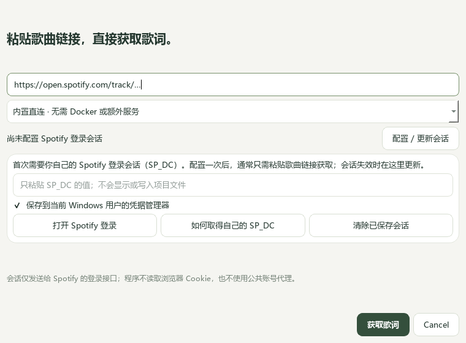

# Spotify 歌词接入

从 Mio 1.3 开始，默认使用**内置直连**：在 MioMusic.exe 内完成令牌请求、歌词获取与 LRC 转换，无需安装 Docker、PHP 或单独启动 spotify-lyrics-api 服务。实现参考 [akashrchandran/spotify-lyrics-api](https://github.com/akashrchandran/spotify-lyrics-api) 的自有会话流程；不是 Spotify 官方授权集成。

## 首次配置

1. 在歌词页点击 **Spotify 获取…**，保持“内置直连”模式。
2. 点击“打开 Spotify 登录”，在自己的浏览器登录自己的账号。
3. 在该浏览器按 F12 打开开发者工具，进入 **Application / 应用程序 → Storage / 存储 → Cookies → https://open.spotify.com**（浏览器名称可能不同）。查找 `sp_dc`，复制其 **Value / 值**。如果没有此项，确认网页版已登录，并刷新页面。
4. 只把这个值粘贴到 **Mio 的 SP_DC 输入框**，不要附加 `sp_dc=`，不要粘贴整个 Cookie 请求头。默认保存到当前 Windows 用户的凭据管理器；也可以取消保存，只在本次运行使用。
5. 粘贴 Spotify **歌曲链接**，点击“获取歌词”。支持 22 位 Track ID 和 `spotify:track:` URI；不支持专辑或播放列表链接。

SP_DC 是敏感登录会话，不要发到聊天、提交 GitHub 或交给不可信网站。程序不会自动读取或提取浏览器 Cookie。此流程仍需你自己的有效 Spotify 会话，无法保证账号、地区或没有歌词的曲目可用。

## 配置后一步获取



已有本机会话后，可把 Spotify 歌曲链接直接粘贴到歌词页的**曲名搜索框**，点击 **查找歌词**。Mio 识别链接后直接获取，无需再打开配置窗口，也无需先启动服务。也可以通过“Spotify 获取…”窗口粘贴链接获取。

“已有本机会话”仅表示存在配置，有效性在实际请求时验证。过期时点击“配置 / 更新会话”，用自己的新 SP_DC 更新；“清除已保存会话”会移除本机凭据和内存令牌。关闭程序也会清除内存令牌。取消“保存”仅在本次运行使用新会话，不修改此前已保存的会话；要彻底删除旧配置请使用清除按钮。

## 保存与数据流

- Windows 凭据目标：`MioMusic/Spotify/SP_DC`。由当前 Windows 用户的系统凭据存储管理；不写入 QSettings、歌词缓存、运行记录或项目文件。这不意味着能防御已控制当前用户会话的软件。
- SP_DC 只发送到 `https://open.spotify.com/api/token`；返回的访问令牌仅在内存缓存，并用于 Spotify 歌词接口。请求不跟随重定向，启用 TLS 校验。
- 公共时间与协议参数分别读取 Spotify 的 server-time 和 [spot-secrets-go 的参数文件](https://github.com/xyloflake/spot-secrets-go/blob/main/secrets/secretDict.json)，这些请求不带你的会话或访问令牌。网络需能访问这些域名；外部参数仍有可用性依赖。
- 登录失效和服务拒绝会明确提示，不回显包含会话的原始响应或网络异常。401 只更新一次内存令牌，403 不反复重试。

## 获取后如何写入

成功获取后歌词进入编辑区，并添加到当前歌曲的可选版本中。可离线生成日语罗马音，在“写入与记录”中选择 Spotify 原文、当前编辑内容、原文＋罗马音预览，或保留文件原歌词；选择封面和保存方式后确认预览再保存。

Spotify 接入按歌曲链接 / ID 获取，尚不支持根据本地曲名自动搜索 Spotify。原来的网易云、酷狗、LRCLIB 搜索仍可独立使用。失败不会清空当前编辑内容。

## 失败提示

- 401 / 未接受会话：在 Mio 更新自己的 SP_DC 后重试。
- 403：检查账号、地区、会话状态；程序不会绕过服务端拒绝。
- 404：歌曲没有可用歌词，或内部接口已变化。
- 429：请求过频，请稍后重试。
- 网络 / 证书 / 超时：确认本机能访问 Spotify 和 GitHub 原始文件域名，检查系统时间。
- 登录协议参数变化：更新 Mio，或切换自建服务；内部接口可能随时失效。

## 高级：继续使用自建服务

1. 安装并启动 Docker Desktop，选择 Linux 容器模式。
2. 在 Mio 解压目录（或源码根目录）打开 PowerShell，运行：

```powershell
powershell -ExecutionPolicy Bypass -File .\scripts\start-spotify.ps1
```

3. 脚本会交互询问你自己 Spotify 会话的 `SP_DC`，输入不会显示。请按上游的 [会话说明](https://github.com/akashrchandran/spotify-lyrics-api#deployment) 在自己的浏览器中查看；不要发到聊天、提交 GitHub 或粘贴到不可信网站。
4. 脚本构建并启动容器，服务监听 `http://127.0.0.1:8765/`。首次构建需要下载 PHP 基础镜像和依赖。
5. 在 Mio 的“歌词与罗马音”页点击 **Spotify 获取…**，切换“高级 · 使用自己的 spotify-lyrics-api 服务”，填写本地服务地址，粘贴歌曲链接，点击“获取并预览”。也支持 22 位 Track ID 和 `spotify:track:` URI。

SP_DC 通过进程环境传入 Docker，不写入项目 `.env` 或配置文件。Docker 容器配置仍保存该环境变量，能够管理 Docker 的本机用户可能查看它。停止使用时删除容器；不要分享容器检查输出。脚本执行后会清除自身的 SP_DC 环境变量。

停止并删除本地服务：

```powershell
docker stop mio-spotify-lyrics
docker rm mio-spotify-lyrics
```

会话过期后重新运行启动脚本，填写自己的新会话。在自建服务模式，Mio 仅保存服务地址，会话由你自己的服务管理。远程自建服务地址必须使用 HTTPS，本地回环地址可使用 HTTP；本版地址栏不接受带账号、密码或密钥查询参数的 URL。

## 上游与验证边界

内置 Python 适配参考 spotify-lyrics-api 的会话、协议参数与取词流程移植，采用 GPL-3.0-only；保留上游版权与完整可选服务源码。随包的 `integrations/spotify-lyrics-api` 固定提交 `e158b96b854778d8ff51a3c9544ebb4f68b64907`，修改见 `UPSTREAM.md`。

自动测试覆盖协议参数、令牌缓存、401 刷新、403 停止、凭据隔离、原生 Windows 凭据读写、首次配置窗口和主界面链接获取。最终 EXE 另检查内置适配、原生配置窗口及独立测试凭据的写入 / 清除。**协议使用模拟响应；没有使用真实 Spotify 个人会话完成歌词获取，不能把测试通过当作真实账号可用证明。** 公共时间和参数接口已单独检查返回 HTTP 200。可选服务另有 CI 构建 / PHP 检查。

这是非官方接口，上游提示过服务条款方面的不确定性；接口、登录流程和网络变化都可能使功能失效。歌词版权仍归各自权利人。
